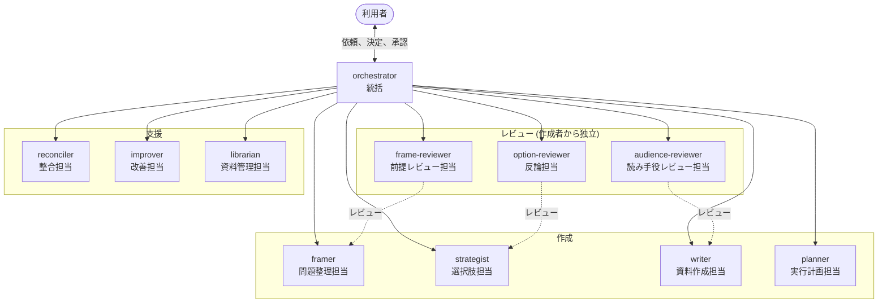

# エージェントの組織とスキルの割当て

役割ごとにエージェントを分け、それぞれが自分の役割に要るスキルだけを読む。オーケストレーターは成果物の中身を読まず、ID と報告だけを扱う。これでどのエージェントの文脈も小さく保つ。

## 組織図

- エージェントどうしは直接やり取りしない。依頼と報告はすべて orchestrator を通る。
- 成果物はファイルで受け渡す。orchestrator が渡すのは ID とファイルの場所だけ。

## 割当て

| エージェント | 日本語名 | 読むスキル | 編集 |
|---|---|---|---|
| orchestrator | 統括 | solve | まとめ、初期設定 |
| framer | 問題整理担当 | solve-base、solve-framing | SIT、ISS、トレース表、台帳 |
| strategist | 選択肢担当 | solve-base、solve-options | OPT、トレース表、台帳 |
| writer | 資料作成担当 | solve-base、solve-proposal | ARG、DOC、トレース表、台帳 |
| planner | 実行計画担当 | solve-base、solve-plan | PLN、トレース表、台帳 |
| frame-reviewer | 前提レビュー担当 | solve-base、solve-review、solve-framing | なし |
| option-reviewer | 反論担当 | solve-base、solve-review、solve-options | なし |
| audience-reviewer | 読み手役レビュー担当 | solve-base、solve-review、solve-proposal | なし |
| reconciler | 整合担当 | solve-base、solve-reconcile | トレース表、台帳 |
| librarian | 資料管理担当 | solve-base、solve-library | 資料の索引 |
| improver | 改善担当 | solve-base、solve-improve | 固有ルール、学びの記録、スキル |

## 工程

| 工程 | すること | 作るもの | 順に動く担当 |
|---|---|---|---|
| `frame` | 問題を整理する (状況、関係者、論点) | SIT、ISS | framer |
| `options` | 選択肢を出して比べる | OPT | strategist |
| `propose` | 説得の筋道と提案資料を作る | ARG、DOC | writer |
| `plan` | 小さく試す計画を作る | PLN | planner |
| `all` | 整理から提案資料まで通しで進める | SIT、ISS、OPT、ARG、DOC | framer → strategist → writer |

## 割当てを変える

| 範囲 | 方法 |
|---|---|
| ある場所だけ、スキルを足す | `.solve/project.yml` の `agent_skills` に書く |
| 全体で変える | `.github/agents/<名前>.agent.md` の「スキル」の行を直し、`python tools/sync_agents.py` で Claude Code 用を作り直す |
| エージェントを足す | `.github/agents/` に定義を足して同じく生成し、`.github/skills/solve/SKILL.md` の割り振りの表と逆引き辞典に加える |
| スキルを足す | `.github/skills/<名前>/SKILL.md` を作り、使わせたいエージェントに割り当てる |

直したあとは `python tools/check_links.py` で、参照先の抜けと未記入のスキルを確かめる。
